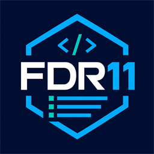

# FDR11.Logger



Configurazione Serilog standard per applicazioni .NET 10 e ASP.NET Core:
log strutturati CLEF/JSON, file rolling, correlation ID e tracing distribuito.

La documentazione completa, gli esempi di integrazione e le istruzioni di
rilascio sono disponibili in [Code/README.md](Code/README.md).

## Build

```powershell
dotnet build FDR11.Logger.slnx --configuration Release
dotnet pack Code/FDR11.Logger.csproj --configuration Release --output artifacts
```

Il pack genera sia `FDR11.Logger.1.0.0.nupkg` sia
`FDR11.Logger.1.0.0.snupkg`.
